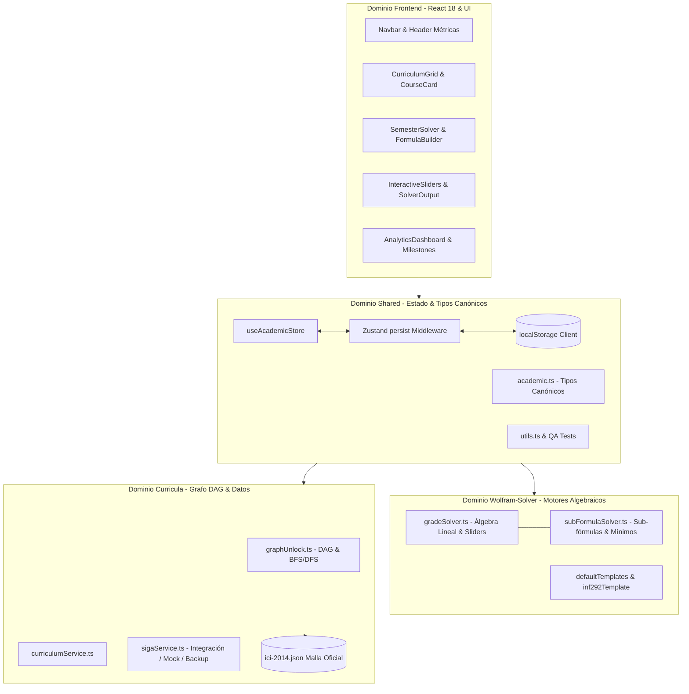
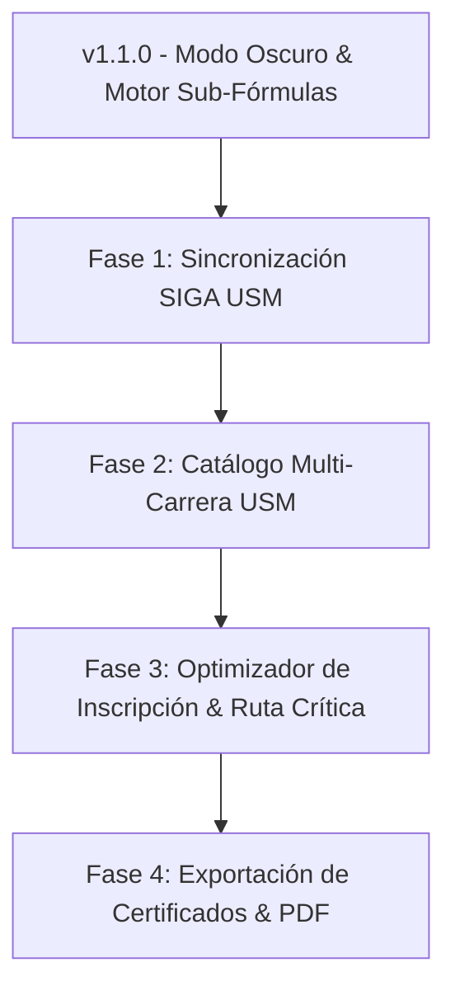

# USM Malla & Grade Solver — Memoria Técnica y Documentación Maestra (CONTEXT.md)

Este documento constituye la memoria viva, especificación funcional y guía arquitectónica del repositorio **USM Malla & Grade Solver** (`SansanoTracker`). Define las decisiones de diseño, modelos matemáticos, flujos de estado y evolución histórica del proyecto.

---

## 1. Idea General del Proyecto

**USM Malla & Grade Solver** es una aplicación web de página única (**SPA - Single Page Application**), 100% de ejecución del lado del cliente (*client-side only*), diseñada específicamente para la comunidad estudiantil de la **Universidad Técnica Federico Santa María (USM)**, Chile.

### 1.1 Principios Fundamentales
* **Ejecución 100% Estática y Descentralizada:** No depende de un backend propietario ni almacena datos en bases de datos remotas no autorizadas. El despliegue se realiza directamente sobre **GitHub Pages**.
* **Privacidad y Persistencia Local:** Todo el avance académico, notas parciales, configuraciones de ramos e hitos de graduación residen exclusivamente en el navegador del usuario a través de la API `localStorage`. Dispone de importación y exportación de respaldos en formato JSON cifrado/estructurado.
* **Ergonomía Sansana:** La interfaz, terminología, ponderaciones y escalas de evaluación responden a los reglamentos y dinámicas académicas reales de la USM (siglas institucionales, certámenes, controles, laboratorios, créditos SCT vs USM, y nota mínima de aprobación 55).

### 1.2 Doble Propósito Funcional

```mermaid
flowchart LR
    A[Estudiante Sansano] --> B[Malla Curricular Interactiva DAG]
    A --> C[WolframAlpha USM - Grade Solver]
    
    subgraph Malla [Malla Curricular Interactiva]
        B --> B1[Visualización Semestre a Semestre 1 al 11]
        B --> B2[Desbloqueo de Prerrequisitos en DAG]
        B --> B3[KPIs: Créditos SCT, USM, GPA, Avance %]
        B --> B4[Hitos de Titulación: Bachiller, Licenciatura, Prácticas]
    end

    subgraph Solver [Calculadora & Solver de Notas]
        C --> C1[Despeje Algebraico Lineal NF >= 55]
        C --> C2[Sub-Fórmulas Encadenadas: PCE, PC, PP]
        C --> C3[Operadores min() para descarte de peores notas]
        C --> C4[Restricciones de Muerte Súbita y Penalización USM]
    end
```

1. **Malla Curricular Interactiva (Grafo Acíclico Dirigido - DAG):**
   * Representación formal de la malla curricular (inicialmente Ingeniería Civil Informática, Plan 2014, con 59 asignaturas).
   * Clasificación reactiva del estado de cada asignatura:
     * `APPROVED` (Aprobado): El alumno ya cursó y aprobó la asignatura.
     * `IN_PROGRESS` (En Curso): El alumno se encuentra rindiendo la asignatura en el semestre activo.
     * `AVAILABLE` (Disponible): Todos los prerrequisitos directos están aprobados; apta para inscripción.
     * `LOCKED` (Bloqueada): Falta al menos un prerrequisito directo para desbloquearla.
   * Detección algorítmica de cadenas de dependencia y validación de ausencia de dependencias circulares (topological sorting).
   * Panel de estadísticas académicas en tiempo real: Créditos USM aprobados vs requeridos, Créditos SCT (300 requeridos), porcentaje general de avance y cálculo de promedio ponderado acumulado (GPA).

2. **Calculadora y Solucionador de Notas ("WolframAlpha USM"):**
   * Deducción analítica inversa de notas necesarias en evaluaciones pendientes para alcanzar la meta de aprobación institucional ($NF \ge 55$).
   * Modelado avanzado de sub-fórmulas compuestas ($PCE$, $PC$, $PP$) con pesos globales e intra-bloque.
   * Tratamiento matemático de descarte de peores notas (operador $\min$) frecuente en controles y tareas.
   * Restricciones no negociables de bloque (*sudden-death* o muerte súbita, ej. certámenes $\ge 50$).
   * Regla de penalización condicional oficial USM ($NF = \min(PCE, PC, PP)$ si se reprueba cualquier bloque mínimo).
   * Simulador dinámico con *interactive sliders* para evaluar escenarios hipotéticos redistribuyendo la exigencia en evaluaciones libres.

---

## 2. Arquitectura y Stack Tecnológico

El proyecto sigue una arquitectura desacoplada y orientada a tipos, estructurada en dominios modulares independientes: interfaz de usuario (`frontend/`), resolución de notas y restricciones algebraicas (`wolfram-solver/`), planes de estudio y grafos curriculares (`curricula/`), y estado y utilidades transversales (`shared/`).



### 2.1 Especificaciones Técnicas

| Área | Tecnología | Versión / Detalle | Justificación |
|---|---|---|---|
| **Frontend Framework** | **React** | `^18.3.1` | Manejo reactivo de componentes, hooks modernos (`useMemo`, `useCallback`) y alta velocidad de renderizado. |
| **Lenguaje** | **TypeScript** | `^5.6.3` | Tipado estricto extremo (`strict: true`), seguridad en contratos de datos y eliminación de fallos en tiempo de ejecución. |
| **Bundler & Tooling** | **Vite** | `^5.4.10` | Inicio instantáneo en desarrollo (HMR impulsado por ESM nativo) y compilación optimizada con Rollup. |
| **Estilos & CSS** | **Tailwind CSS** | `^3.4.14` | Utilidades utilitarias de alto rendimiento, sistema de tokens semánticos corporativos USM y diseño *mobile-first*. |
| **Sistema de Componentes** | **shadcn/ui + Radix UI** | Primitivas accesibles | Componentes desacoplados, altamente accesibles (ARIA) sin ataduras a librerías pesadas. |
| **Modo Oscuro** | CSS Variables + Tailwind | Nativo `zinc-950` / `slate-950` | Modo oscuro predeterminado de alto contraste, descansado para sesiones nocturnas de estudio. |
| **Gestión de Estado** | **Zustand** | `^4.5.5` | Almacén unificado, reactivo y ligero (<2KB) sin boilerplate de Redux, con middleware `persist`. |
| **Motor Matemático** | Módulos TypeScript puros | Funciones deterministas | Cero efectos secundarios; facilita pruebas unitarias aisladas y garantiza exactitud de cálculo. |
| **CI/CD & Hosting** | **GitHub Actions + Pages** | Action `actions/deploy-pages@v4` | Despliegue continuo automático a la rama `gh-pages` con cada push a `main`. |

---

## 3. Estructura de Carpetas del Proyecto

```text
Malla_USM/
├── .github/
│   └── workflows/
│       └── deploy.yml              # Pipeline CI/CD automático para GitHub Pages
├── dist/                           # Salida compilada de producción (generada por Vite)
├── node_modules/                   # Dependencias instaladas vía npm
├── public/                         # Recursos estáticos servidos directamente
├── src/
│   ├── curricula/                  # Dominio curricular, planes de estudio y resolución de prerrequisitos
│   │   ├── careers/
│   │   │   └── ici-2014.json       # Malla oficial 7313 (Civil Informática Plan 2014)
│   │   ├── prerequisites/
│   │   │   └── graphUnlock.ts      # Algoritmos de grafos (DAG, detección de ciclos, BFS/DFS y desbloqueos)
│   │   ├── services/
│   │   │   ├── curriculumService.ts# Proveedor de planes de estudio y créditos
│   │   │   └── sigaService.ts      # Abstracción y parseo para portal SIGA USM
│   │   └── index.ts                # Punto de exportación pública del dominio curricula
│   ├── frontend/                   # Dominio de presentación e interfaz de usuario React
│   │   ├── components/
│   │   │   ├── analytics/
│   │   │   │   └── AnalyticsDashboard.tsx # Métricas de titulación, GPA, avance SCT e hitos
│   │   │   ├── curriculum/
│   │   │   │   ├── CourseCard.tsx         # Tarjeta interactiva de asignatura con estados y colores
│   │   │   │   ├── CourseDetailModal.tsx  # Modal de inspección profunda y dependencias del ramo
│   │   │   │   ├── CurriculumGrid.tsx     # Grilla horizontal/vertical de los 11 semestres
│   │   │   │   └── SemesterColumn.tsx     # Contenedor de asignaturas pertenecientes a un semestre
│   │   │   ├── layout/
│   │   │   │   ├── DataBackupModal.tsx    # Modal de exportación/importación de JSON
│   │   │   │   ├── Footer.tsx             # Pie institucional USM de código abierto
│   │   │   │   └── Navbar.tsx             # Navegación principal, contadores y botones de acción
│   │   │   ├── solver/
│   │   │   │   ├── CourseSolverCard.tsx   # Tarjeta modular para cálculo individual de ramo
│   │   │   │   ├── FormulaBuilder.tsx     # Editor estructurado de grupos, pesos y evaluaciones
│   │   │   │   ├── InteractiveSliders.tsx # Sliders dinámicos para simulación de notas "what-if"
│   │   │   │   ├── SemesterSolver.tsx     # Vista orquestadora de asignaturas en curso
│   │   │   │   └── SolverOutput.tsx       # Desglose numérico y alertas de restricción vinculante
│   │   │   └── ui/                        # Primitivas modulares shadcn/ui (Button, Dialog, Badge, Tabs, etc.)
│   │   └── styles/
│   │       └── index.css                  # Estilos globales, variables HSL corporativas USM y tema oscuro
│   ├── shared/                     # Dominio transversal: estado reactivo, tipos y utilidades
│   │   ├── lib/
│   │   │   └── utils.ts                   # Helpers compartidos (`cn` para concatenación de clases Tailwind)
│   │   ├── store/
│   │   │   └── useAcademicStore.ts        # Store global Zustand con middleware de persistencia en localStorage
│   │   ├── tests/
│   │   │   └── qaIntegration.test.ts      # Suite integral de QA (persistencia, INF-292, penalización y backups)
│   │   └── types/
│   │       └── academic.ts                # Definiciones canónicas de tipos TypeScript del dominio
│   ├── wolfram-solver/             # Dominio motor algebraico ("WolframAlpha USM") y plantillas
│   │   ├── engine/
│   │   │   ├── gradeSolver.ts             # Algoritmo de resolución lineal y análisis de restricciones
│   │   │   └── subFormulaSolver.ts        # Motor matemático para sub-fórmulas y regla de penalización USM
│   │   ├── templates/
│   │   │   ├── defaultTemplates.ts        # Silabos base y ponderaciones estándar USM
│   │   │   └── inf292Template.ts          # Plantilla oficial INF-292 (PCE, PC, PP con mínimos)
│   │   ├── tests/
│   │   │   ├── gradeSolver.test.ts        # Suite de tests unitarios del solver general
│   │   │   └── subFormulaSolver.test.ts   # Suite de tests unitarios de sub-fórmulas y mínimos de bloque
│   │   └── index.ts                # Punto de exportación pública del motor wolfram-solver
│   ├── App.tsx                     # Componente raíz con control de vistas por pestañas
│   └── main.tsx                    # Punto de entrada de la aplicación en el DOM
├── index.html                      # Plantilla HTML5 con viewport optimizado
├── package.json                    # Manifiesto de dependencias y scripts de construcción
├── tailwind.config.js              # Configuración de colores corporativos USM y plugins
├── tsconfig.json                   # Configuración del compilador TypeScript
└── vite.config.ts                  # Configuración de Vite con alias `@` apuntando a `src/`
```

---

## 4. Reglas de Negocio USM Modeladas

El núcleo matemático del sistema replica fielmente la reglamentación académica y los reglamentos docentes de la Universidad Técnica Federico Santa María:

### 4.1 Escala y Condición Global de Aprobación
* **Escala Institucional:** Las calificaciones son valores escalares acotados en el intervalo cerrado:
  $$\text{Nota} \in [0, 100]$$
* **Nota de Aprobación ($NF_{\text{aprob}}$):**
  $$NF \ge 55$$

### 4.2 Despeje Lineal Estándar de Notas Faltantes
Dado un ramo compuesto por $G$ grupos de evaluación con pesos normalizados $W_g$ ($\sum_{g=1}^G W_g = 1$) y cada grupo subdividido en evaluaciones con pesos normalizados $w_{g,e}$ ($\sum_{e=1}^{E_g} w_{g,e} = 1$):
* **Peso Global de una Evaluación:**
  $$\alpha_e = W_g \cdot w_{g,e}$$
* **Puntaje Acumulado por Evaluaciones Conocidas ($K$):**
  $$P_{\text{acum}} = \sum_{e \in K} \alpha_e \cdot N_e$$
* **Ponderación Restante de Evaluaciones Desconocidas ($U$):**
  $$\alpha_{\text{rest}} = \sum_{e \in U} \alpha_e$$
* **Nota Uniforme Necesaria ($X_{\text{global}}$):**
  $$X_{\text{global}} = \frac{55 - P_{\text{acum}}}{\alpha_{\text{rest}}}$$

---

### 4.3 Sub-fórmulas Encadenadas y Caso Real INF-292 (Optimización / IO)
Muchos ramos de la USM (tales como **INF-292 - Modelación y Optimización**, **FIS-100**, **MAT-021**) no aplican una fórmula lineal simple, sino un sistema encadenado de sub-fórmulas intermedias con reglas de descarte y umbrales mínimos:

#### Estructura de Sub-fórmulas en INF-292:
1. **Sub-fórmula PCE (Promedio de Controles de Entrada):**
   * Se rinden $7$ controles breves: $CE_1, CE_2, \dots, CE_7$.
   * Se elimina la peor nota obtenida:
     $$PCE = \frac{\sum_{i=1}^7 CE_i - \min_{1 \le i \le 7}(CE_i)}{6}$$
   * Ponderación en nota final: $10\%$.
   * Exigencia mínima de bloque: $PCE \ge 50$.

2. **Sub-fórmula PC (Promedio de Certámenes Teórico-Prácticos):**
   * Se rinden $3$ certámenes semestrales: $C_1, C_2, C_3$.
   * Ponderación en nota final: $45\%$.
   * Exigencia mínima de bloque: $PC \ge 50$.

3. **Sub-fórmula PP (Promedio de Proyectos y Entregas):**
   * Se compone de $3$ entregas del proyecto semestral: $E_1, E_2, E_3$.
     $$PP = \frac{E_1 + E_2 + E_3}{3}$$
   * Ponderación en nota final: $45\%$.
   * Exigencia mínima de bloque: $PP \ge 50$.

---

### 4.4 Condiciones de Muerte Súbita (*Sudden-Death*) y Regla de Penalización USM
En ramos de ingeniería USM, la nota ponderada final es condicional al cumplimiento simultáneo de mínimos aprobatorios por bloque.

#### 1. Condición de Bloques Mínimos:
Para optar al promedio ponderado regular, el estudiante debe satisfacer:
$$PCE \ge 50 \quad \land \quad PC \ge 50 \quad \land \quad PP \ge 50$$

#### 2. Ecuación Condicional de Nota Final ($NF$):
$$\text{NF} = \begin{cases} 
0.10 \cdot PCE + 0.45 \cdot PC + 0.45 \cdot PP & \text{si } PCE \ge 50 \land PC \ge 50 \land PP \ge 50 \\
\min(PCE, PC, PP) & \text{en caso contrario (Regla de Penalización USM)}
\end{cases}$$

> [!WARNING]
> **Impacto de la Regla de Penalización:** Si un estudiante alcanza un promedio acumulado de 75 en controles y 80 en proyecto, pero obtiene un promedio de certámenes $PC = 48$, la regla de penalización USM invalida el promedio ponderado y fija automáticamente la nota final en:
> $$NF = \min(75, 48, 80) = 48$$
> resultando en la reprobación del ramo. El motor matemático (`gradeSolver.ts`) detecta activamente estas restricciones vinculantes (*binding constraints*), alertando al alumno sobre la nota mínima requerida en cada bloque particular antes de calcular la media global.

---

## 5. Historial de Versiones (Changelog)

### v1.0.0 — MVP Inicial
* **Malla Curricular Completa ICI Plan 2014:**
  * Modelado exhaustivo de 59 asignaturas organizadas a lo largo de 11 semestres curriculares.
  * Inclusión de metadatos completos: código institucional, nombre, créditos USM, créditos SCT, área formativa (Ciencias Básicas, Informática, Gestión, etc.) y prerrequisitos directos.
* **Motor de Grafo DAG (`graphUnlock.ts`):**
  * Clasificación algorítmica de estados (`APPROVED`, `IN_PROGRESS`, `AVAILABLE`, `LOCKED`).
  * Análisis de rutas de desbloqueo futuro si se aprueba una asignatura objetivo.
  * Validación de aciclicidad mediante DFS con detección de aristas de retroceso.
* **Primer Grade Solver Algebraico:**
  * Bloques ponderados estándar con certamen recuperativo y cálculo de $X_{\text{global}}$.
  * Soporte para detección de "Matemáticamente Aprobado" o "Requiere Recuperativo".
* **Dashboard de Titulación & Hitos de Graduación:**
  * Indicadores de Bachiller en Ciencias de la Ingeniería (Semestres 1 a 4).
  * Licenciatura en Ciencias de la Ingeniería (Semestres 1 a 8).
  * Acreditación TOEIC ($\ge 550$ pts) y Prácticas Industriales / Profesionales.
* **Persistencia y Respaldo:**
  * Almacenamiento local mediante Zustand + `localStorage`.
  * Importación/Exportación en formato JSON.

---

### v1.1.0 — Refactorización Modo Oscuro & Motor de Sub-Fórmulas INF-292
* **Modo Oscuro Predeterminado (Dark Mode First):**
  * Adopción de la paleta moderna oscura `zinc-950` / `slate-950` como esquema principal en todo el sitio.
  * Integración de acentos institucionales USM (`#002B49` Azul Marino y `#D99B00` Dorado Sansano).
  * Eliminación de destellos en recarga y optimización de contrastes para legibilidad de textos y badges.
* **Rediseño Radical de la Vista "Ramos en Curso / Solver":**
  * Simplificación de la interfaz gráfica: sustitución de tablas densas y formularios extensos por tarjetas modulares compactas, minimalistas y sin saturación cognitiva.
  * Pestañas limpias para alternar entre "Calculadora Solver" y "Configuración de Fórmula".
  * Integración de selectores rápidos para inscribir ramos con 1 solo clic desde la malla.
* **Motor Matemático Avanzado de Sub-fórmulas Encadenadas:**
  * Soporte formal para operadores agregados: sumatorias parciales descartando la peor nota ($\min$).
  * Modelado de variables intermedias encadenadas ($PCE$, $PC$, $PP$) previo a la nota final.
  * Evaluación de la regla de penalización oficial USM: asignación de $NF = \min(\dots)$ ante incumplimiento de umbrales individuales de corte.
* **Plantilla Oficial Precargable INF-292 (Optimización):**
  * Plantilla lista para usar con las 3 sub-fórmulas reales (7 controles descartando 1, 3 certámenes con opción de recuperativo y 3 entregas de proyecto).
* **Documentación Viva Unificada:**
  * Creación y consolidación de la memoria técnica del repositorio en `CONTEXT.md`.

---

## 6. Próximas Fases y Roadmap



1. **Sincronización Automática con Portal SIGA USM (Arquitectura Híbrida Documentada):**
   * Ver especificación técnica detallada en [`docs/SIGA_SCRAPER_ARCHITECTURE.md`](./docs/SIGA_SCRAPER_ARCHITECTURE.md) y motor autónomo de respaldo en `scripts/siga-scraper/`.
   * Modelo híbrido (Opción C): sincronización de catálogos JSON (`horario_asignaturas.json`, `planes_carreras.json`, `programas_academicos.json`, `professors_view.json`) vía CDN/GitHub Actions con fallback local y scraper Python autónomo en caso de contingencia.
   * Cero almacenamiento externo: el parseo y estado del estudiante se ejecutan íntegramente en memoria en el cliente.
2. **Catálogo Multi-Carrera y Nuevos Planes 2024:**
   * Soporte para el nuevo Plan 2024 de Ingeniería Civil Informática e incorporación de planes para Ingeniería Civil Industrial, Eléctrica, Mecánica, etc.
   * Selector dinámico de plan y carrera en la barra de navegación superior.
3. **Optimizador de Ruta Crítica e Inscripción Semestral:**
   * Algoritmo de camino crítico que identifique cuellos de botella curriculares (ej. ramos prerrequisito de múltiples cadenas posteriores como INF-134 o FIS-110).
   * Sugerencia de combinaciones de ramos a inscribir para equilibrar carga de créditos y asegurar el egreso en 11 semestres.
4. **Exportación e Impresión Vectorial:**
   * Generación de la malla personalizada en formato PDF o SVG con estados coloreados para impresión en gran formato.

---

## 7. Instrucciones para Desarrolladores

### 7.1 Requisitos Previos
* **Node.js:** Versión `>= 18.0.0` (recomendado Node 20 LTS).
* **NPM:** Versión `>= 9.0.0`.

### 7.2 Configuración Local

```bash
# 1. Clonar el repositorio
git clone https://github.com/tu-usuario/Malla_USM.git
cd Malla_USM

# 2. Instalar dependencias
npm install

# 3. Iniciar entorno de desarrollo local con HMR
npm run dev

# 4. Compilar proyecto y verificar tipos TypeScript
npm run build

# 5. Previsualizar la compilación de producción localmente
npm run preview
```

### 7.3 Verificación y Pruebas
Las suites de pruebas automatizadas del motor matemático y de integración se ejecutan mediante npm o directamente con el compilador/ejecutor `tsx`:
```bash
# Ejecución completa de todos los suites (sub-fórmulas, solver y QA):
npm test

# O ejecución individual de suites:
# 1. Pruebas unitarias de sub-fórmulas y regla de penalización USM
npx tsx src/wolfram-solver/tests/subFormulaSolver.test.ts

# 2. Pruebas unitarias del motor general y DAG de prerrequisitos
npx tsx src/wolfram-solver/tests/gradeSolver.test.ts

# 3. Suite de validación integral QA, INF-292 y compatibilidad de persistencia
npx tsx src/shared/tests/qaIntegration.test.ts
```
Todas las aserciones de normalización de pesos, despeje de notas, análisis de muerte súbita, descarte de notas (`min`), penalizaciones USM y persistencia reportan estado exitoso `✓` / `✅`.
