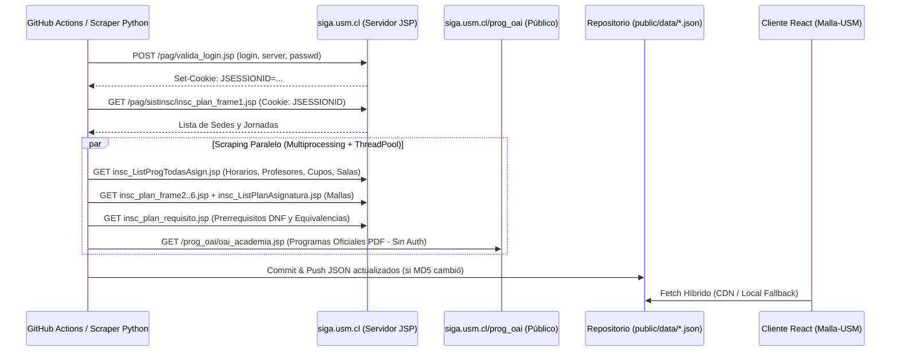

# Arquitectura de Ingeniería Inversa y Scraping Autónomo de SIGA USM

Este documento detalla la ingeniería inversa realizada sobre el **Sistema de Información y Gestión Académica (SIGA)** de la **Universidad Técnica Federico Santa María (`siga.usm.cl`)**, documentando los endpoints JSP internos, la estructura de sus tablas HTML, el manejo de sesiones y el funcionamiento del motor de scraping autónomo incluido en `scripts/siga-scraper/`.

> [!IMPORTANT]
> **Propósito de Contingencia y Soberanía de Datos:**
> Nuestro proyecto opera bajo un modelo **Híbrido (Opción C)**:
> 1. **Fuente Primaria (Upstream Mirror & CDN):** Sincroniza periódicamente los JSON pre-compilados desde el repositorio comunitario [`AlvinIsCrack/horario-usm`](https://github.com/AlvinIsCrack/horario-usm) para evitar sobrecargar innecesariamente los servidores de SIGA y no exponer credenciales personales en el uso diario.
> 2. **Modo Autónomo de Respaldo (`scripts/siga-scraper/`):** Si el repositorio upstream deja de actualizarse, cambia a privado o es eliminado, este repositorio cuenta con el **scraper completo en Python** listo para conectarse directamente a SIGA utilizando credenciales propias en GitHub Secrets (`SIGA_LOGIN`, `SIGA_SERVER`, `SIGA_PASSWD`).

---

## 1. Flujo General de Conexión a SIGA

El portal `siga.usm.cl` está construido sobre **Java Server Pages (JSP)** clásico renderizado en el servidor con layouts basados en `<frameset>` y tablas HTML anidadas. Debido a que SIGA no expone una API REST pública ni cabeceras `Access-Control-Allow-Origin` (CORS), **ningún navegador web puede consultar SIGA directamente desde una SPA en otro dominio**.

La solución consiste en ejecutar la extracción desde un entorno backend o **pipeline de CI/CD (GitHub Actions)** mediante peticiones HTTP con persistencia de cookies (`JSESSIONID`) y almacenar el resultado como archivos JSON estáticos versionados.



---

## 2. Endpoints Internos de SIGA (`siga.usm.cl`)

### 2.1 Autenticación y Obtención de `JSESSIONID`
* **URL:** `https://siga.usm.cl/pag/valida_login.jsp`
* **Método:** `POST` (`application/x-www-form-urlencoded`)
* **Payload:**
  * `login`: Nombre de usuario institucional sin dominio (ej. `juan.perez`)
  * `server`: Dominio de correo USM (ej. `sansano.usm.cl` o `alumnos.usm.cl`)
  * `passwd`: Contraseña de SIGA
* **Validación:**
  * Si el cuerpo de la respuesta contiene `"error_ingreso_login.jsp"`, las credenciales son inválidas.
  * Si es exitoso, el servidor entrega la cookie `JSESSIONID`, la cual debe enviarse en la cabecera `Cookie: JSESSIONID=<valor>` en todas las peticiones siguientes.

---

### 2.2 Catálogo de Sedes y Jornadas
* **URL:** `https://siga.usm.cl/pag/sistinsc/insc_plan_frame1.jsp`
* **Método:** `GET` (Requiere `Cookie`)
* **Estructura HTML:**
  * `<select name="sede">`: Contiene `<option value="...">Nombre Sede</option>` (excluyendo `value="-1"`).
  * `<select name="jornada">`: Contiene `<option value="...">Nombre Jornada</option>` (Diurna, Vespertina, etc.).
  * **Detección de sesión expirada:** Si aparece un enlace con `href="CerrarJsp.jsp"`, la cookie `JSESSIONID` caducó.

---

### 2.3 Horarios, Paralelos, Profesores, Cupos y Salas
* **URL:** `https://siga.usm.cl/pag/sistinsc/listados/insc_ListProgTodasAsign.jsp`
* **Parámetros Query (`GET`):**
  * `sede`: Código numérico de la sede.
  * `jornada`: Código numérico de la jornada.
  * `ano`: Año académico (ej. `2026`).
  * `semestre`: Semestre académico (`1`, `2` o `3` para verano).
  * `car=0`: Todas las carreras.
  * `orden=2`: Ordenado por sigla.
* **Estructura de cada fila (`<tr>`) de la tabla principal (7 columnas `<td>`):**
  1. `cells[0]` — **Sigla:** Código de la asignatura (ej. `INF292` o `MAT021`).
  2. `cells[1]` — **Nombre:** Nombre oficial de la asignatura.
  3. `cells[2]` — **Departamento:** Unidad académica que la imparte.
  4. `cells[3]` — **Paralelo:** Número o código del paralelo (ej. `200`, `201`).
  5. `cells[4]` — **Profesor(es) de Cátedra:** Nombres separados por etiquetas `<br>` cuando hay más de un docente.
  6. `cells[5]` — **Cupo Disponible:** Número entero con los cupos libres del paralelo.
  7. `cells[6]` — **Sub-tabla de Horario (`<table>` anidada):**
     Cada fila de la sub-tabla (saltando el encabezado) tiene **7 celdas `<td>`**:
     * `ch[0]`: **Día** (`Lunes`, `Martes`, `Miércoles`, `Jueves`, `Viernes`, `Sábado`, `Domingo`).
     * `ch[1]`: **Bloque(s):** Puede ser un bloque único (`3`) o un rango separado por salto de línea (`1\n2`, que se expande a todos los bloques intermedios).
     * `ch[2]`: Columna separadora (ignorada).
     * `ch[3]`: **Tipo de bloque:** `Cátedra`, `Laboratorio`, `Ayudantía`, `Taller`, etc.
     * `ch[4]`: **Sala:** Nombre o código de la sala (se limpia el prefijo `Sala`, `Lab.`, `Taller`). Si está vacío se asigna `"POR DEFINIR"`.
     * `ch[5]`: **Campus:** Campus específico donde se dicta el bloque.
     * `ch[6]`: **Profesor del bloque:** Docente o ayudante asignado específicamente a ese bloque horario.

---

### 2.4 Carreras, Menciones, Planes y Mallas Curriculares
El sistema de inscripción de SIGA divide la consulta de planes en 6 frames consecutivos:

1. **Carreras por Sede/Jornada (`insc_plan_frame2.jsp`):**
   * `GET https://siga.usm.cl/pag/sistinsc/insc_plan_frame2.jsp?sede={sede}&jornada={jornada}`
   * Extrae `<option value="{carrera_id}">Nombre Carrera</option>`.
2. **Menciones / Especializaciones (`insc_plan_frame3.jsp`):**
   * `GET https://siga.usm.cl/pag/sistinsc/insc_plan_frame3.jsp?carrera={carrera}&sede={sede}&jornada={jornada}`
   * Extrae `<option value="{mencion_id}">Nombre Mención</option>`.
3. **Planes Vigentes (`insc_plan_frame4.jsp`):**
   * `GET https://siga.usm.cl/pag/sistinsc/insc_plan_frame4.jsp?mencion={mencion}&sede={sede}&carrera={carrera_base}`
   * Se descartan los planes cuyo nombre contenga `"No Vigente"`.
4. **Metadatos del Plan (`insc_plan_frame5.jsp`):**
   * `GET https://siga.usm.cl/pag/sistinsc/insc_plan_frame5.jsp?plan={plan}&sede={sede}&carrera={carrera_base}&mencion={mencion}`
   * Extrae inputs ocultos `<input name="duracion" value="...">` y `<input name="creditos" value="...">`.
5. **Asignaturas por Semestre de la Malla (`insc_ListPlanAsignatura.jsp` y `insc_plan_frame6.jsp`):**
   * `GET https://siga.usm.cl/pag/sistinsc/listados/insc_ListPlanAsignatura.jsp?sede={sede}&carrera={carrera}&mencion={mencion}&plan={plan}&duracion={duracion}&creditos={creditos}`
   * Las tablas pares (`find_all("table")[2::2]`) corresponden a cada semestre del plan.
   * Cada fila de asignatura tiene **11 celdas `<td>`**:
     `[sigla, nombre_asignatura, requisito_licenciatura, horas_teoricas, horas_practicas, horas_lab, horas_ayudantia, creditos_sct, departamento, _, _]`
   * Simultáneamente, en `insc_plan_frame6.jsp` se obtiene el identificador interno `cod_asign` buscando el `<input name="cod_asign">` asociado a cada sigla.
6. **Prerrequisitos y Equivalencias en Forma Normal Disyuntiva (`insc_plan_requisito.jsp`):**
   * `GET https://siga.usm.cl/pag/sistinsc/insc_plan_requisito.jsp?plan={plan}&cod_asign={cod_asign}`
   * Modela las condiciones booleanas de SIGA como listas de listas (**DNF - Disjunctive Normal Form**):
     * El operador `+` o vacío agrupa requisitos en un `AND` (mismo sub-arreglo).
     * El operador `ó` separa grupos en un `OR` (nuevo sub-arreglo).
     * Distingue entre prerrequisito (`PRE`) y correquisito (`CO`).

---

### 2.5 Programas Académicos Oficiales en PDF (Endpoint Público OAI)
* **URL Base:** `https://siga.usm.cl/prog_oai/oai_academia.jsp`
* **Autenticación:** **No requiere cookie de sesión** (acceso público).
* **Recorrido:**
  1. Obtiene las sedes del primer `<select>`.
  2. Consulta `?sede={sede_cod}` para listar los departamentos del segundo `<select>`.
  3. Consulta `?sede={sede_cod}&cod_departamento={departamento_cod}` y extrae las 4 tablas (`IMPAR`, `PAR`, `AMBOS`, `ELECTIVO`).
  4. De cada fila extrae el atributo `onclick` que contiene el identificador del archivo PDF y construye la URL de descarga directa:
     `https://siga.usm.cl/prog_oai/programa_download?pdf={programa_url_encoded}`

---

## 3. Cómo Ejecutar el Scraper Autónomo (`scripts/siga-scraper/`)

Si en el futuro necesitamos activar la extracción directa contra SIGA sin depender de ningún repositorio externo:

### 3.1 Requisitos
```bash
pip install -r scripts/siga-scraper/requirements.txt
```

### 3.2 Variables de Entorno Requeridas
Configura en tu entorno local (o en `Settings -> Secrets and variables -> Actions` de GitHub):
* `SIGA_LOGIN`: Tu usuario de SIGA (sin `@sansano.usm.cl`).
* `SIGA_SERVER`: El servidor de correo (ej. `sansano.usm.cl`).
* `SIGA_PASSWD`: Tu contraseña de SIGA.

### 3.3 Comandos de Ejecución
```bash
# Actualizar horarios, paralelos, profesores y cupos del semestre actual:
python scripts/siga-scraper/generar.py --ramos

# Actualizar el catálogo completo de carreras, menciones, planes y mallas USM:
python scripts/siga-scraper/generar.py --carreras

# Actualizar enlaces a programas académicos oficiales en PDF (no requiere credenciales SIGA):
python scripts/siga-scraper/generar.py --programas

# Simulación completa sin escribir en disco:
python scripts/siga-scraper/generar.py --ramos --carreras --dry-run
```

Los archivos generados se escriben de forma atómica (solo si su hash MD5 cambia) en el directorio `public/data/`.
